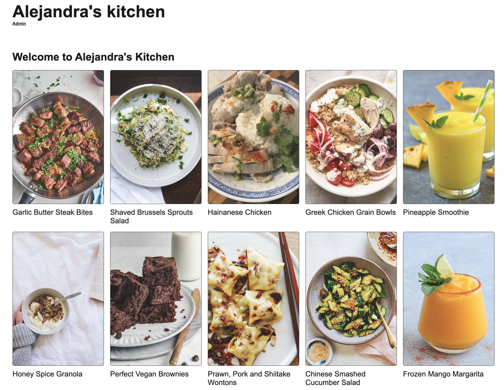
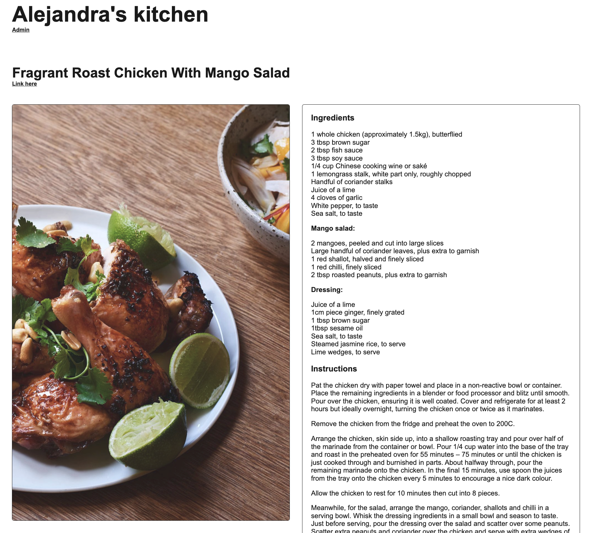

# Alejandra's Kitchen

A collection of favorite web recipes, built with Next.js, React, and Sanity, and hosted on Vercel. Browse recipes without an account; Google sign-in is reserved for allowlisted admins.

[Visit Alejandra's Kitchen](https://next-recipe-app-silk.vercel.app)

## Screenshots

### Recipe collection



### Recipe details



## Local development

Use Node.js 24 LTS and npm:

```sh
npm ci
npm run dev
```

Open [localhost:3000](http://localhost:3000). Recipe content comes from Sanity, so loading recipes and building the app require network access.

## Admin sign-in

Visit `/admin/sign-in` to sign in with an allowlisted Google account. The authentication foundation is implemented; recipe-management screens are planned in later issues.

For local authentication, add the variables from [`.env.example`](.env.example) to `.env.local`, preserving any existing settings:

| Variable | Purpose |
| --- | --- |
| `BETTER_AUTH_URL` | `http://localhost:3000` locally; the main HTTPS website address in production |
| `BETTER_AUTH_SECRET` | Random secret of at least 32 characters |
| `GOOGLE_CLIENT_ID` | Google OAuth web application client ID |
| `GOOGLE_CLIENT_SECRET` | Google OAuth client secret |
| `ADMIN_EMAILS` | Comma-separated verified Google email addresses allowed to sign in |

Generate a secret with `openssl rand -base64 32`. Keep `.env.local` out of version control and restart the development server after changing it.

See [Admin authentication](docs/authentication.md) for Google OAuth setup, session behavior, route-protection examples, and manual verification.

## Production deployment

In **Vercel → Project → Settings → Environment Variables**, add the variables above for the **Production** environment. Use a separate production secret and set:

```dotenv
BETTER_AUTH_URL=https://next-recipe-app-silk.vercel.app
```

If you use a custom domain, substitute that address. Register the matching authorized redirect URI in your Google OAuth client:

```text
https://next-recipe-app-silk.vercel.app/api/auth/callback/google
```

Use Node.js 24 in Vercel's project settings and redeploy after changing environment variables. Local `.env.local` values are not automatically deployed.

## Checks

```sh
npm test
npm run build
```

The tests cover admin authentication, session handling, access guards, safe redirects, and public recipe rendering. Completing Google consent and sign-out with a real account remains a manual check.

## Project planning

See the [PRD](issues/prd.md) and [implementation plan](issues/agent-execution-plan.md) for active and deferred features.
